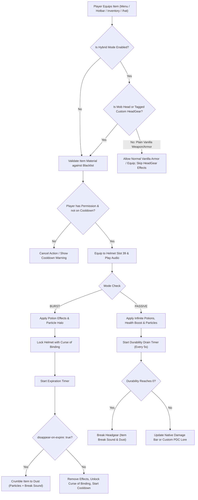
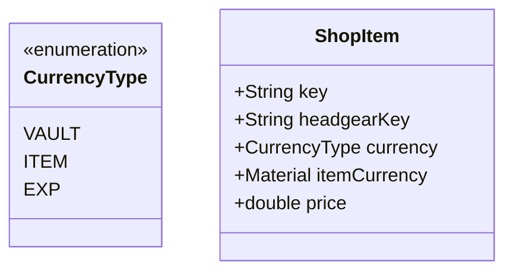
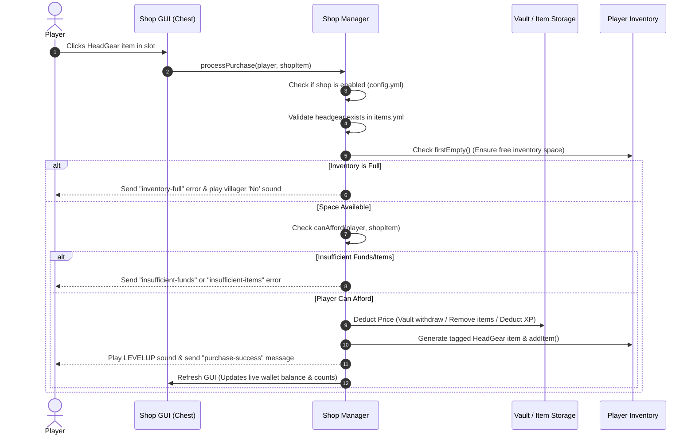

# 👑 HeadGear v7.0 — Official Documentation & Wiki


https://github.com/user-attachments/assets/eaae80eb-98ba-432d-b5cc-638821bce9d1


**The Ultimate Headwear & Cosmetic Ability Plugin for Modern Minecraft Servers**

---

> [!NOTE]
> **HeadGear v7.0** is built from the ground up for modern **Paper**, **Purpur**, and **Spigot** servers running **Minecraft 1.20.x through 1.21.x / 1.26+** on **Java 21+**. It features soft-dependency support for **Vault** economies and completely standalone fallback item trading.

## 🌟 Plugin Overview

HeadGear turns ordinary helmets, survival mob heads, blocks, and custom textured skulls into powerful equipment. Players can equip hats through interactive menus, inventory clicks, or commands to unleash custom potion effects, animated cosmetic particle crowns, and extra health hearts.

### Key Highlights
- **🏆 Hybrid Mode:** Survival mob heads always function directly for players, while regular weapons and armor require designated HeadGear status so players don't accidentally lose or trigger valuable vanilla gear.
- **🔒 Anti-Exploit Curse of Binding:** Prevents players from unequipping headgear mid-battle to exploit timer resets.
- **⏳ Burst & Passive Modes:** Choose between short-lived adrenaline bursts that can vanish upon expiration or permanent passive powers with custom durability drain.
- **🛒 In-Game Shop & Economy:** Fully configurable 54-slot shop supporting Vault money (\$500), physical item barter (Emeralds, Diamonds, Gold, Netherite), and XP levels.
- **🎨 5 Animated Particle Styles:** Dynamic rings, rotating crowns, spinning spirals, floating auras, and movement trails.
- **💀 Custom Textured Mob Heads:** Full Base64 custom skin support for Warden, Enderman, Blaze, and any player skin.

---

## 📦 Installation & Requirements

### Server Requirements
| Component | Minimum Specification | Recommended |
| :--- | :--- | :--- |
| **Server Software** | Paper / Purpur / Spigot 1.20+ | Paper 1.21+ / Paper 26 |
| **Java Version** | Java 21 | Java 21 or Java 25+ |
| **Economy (Optional)** | None (Item Barter works out of the box) | Vault + EssentialsX / Economy Provider |

### Setup Instructions
1. Download `HeadGear-7.0.jar`.
2. Drop `HeadGear-7.0.jar` into your server's `plugins/` directory.
3. Restart or start your server.
4. Default configuration files will automatically generate in `plugins/HeadGear/`:
   - `config.yml` — Global settings & toggles
   - `items.yml` — HeadGear item definitions & stats
   - `shop.yml` — In-game hat store listings & prices

---

## 📐 Architecture & Workflow

The diagram below illustrates how HeadGear handles item validation, mode branching, and unequip lifecycles:



---

## ⌨️ Commands & Permissions

### Commands
| Command | Aliases | Description | Permission |
| :--- | :--- | :--- | :--- |
| `/headgear menu` | `/hats`, `/hg menu`, `/hg wardrobe` | Opens the 54-slot Hat Wardrobe GUI | `headgear.menu` |
| `/headgear shop` | `/hatshop`, `/hg shop`, `/hgstore` | Opens the 54-slot HeadGear Shop GUI | `headgear.shop` |
| `/headgear wear` | `/hat`, `/hg wear`, `/hg equip` | Wears the item currently held in main hand | `headgear.hat` |
| `/headgear unequip` | `/hg unequip`, `/hg remove` | Takes off your current headgear | `headgear.use` |
| `/headgear list` | `/hg list` | Lists all loaded headgear items & modes | `headgear.use` |
| `/headgear give <player> <item> [amount]` | `/hg give` | Admin command: Gives a tagged HeadGear item | `headgear.admin` |
| `/headgear reload` | `/hg reload` | Reloads `config.yml`, `items.yml`, and `shop.yml` | `headgear.admin` |

### Permissions Matrix
| Permission Node | Description | Default |
| :--- | :--- | :--- |
| `headgear.use` | Allows wearing headgear and using `/headgear list`/`unequip` | `true` (All Players) |
| `headgear.hat` | Allows using the `/hat` command | `true` (All Players) |
| `headgear.menu` | Allows opening the Hat Wardrobe GUI | `true` (All Players) |
| `headgear.shop` | Allows opening and buying from the HeadGear Shop GUI | `true` (All Players) |
| `headgear.admin` | Access to admin commands (`/headgear reload`, `/headgear give`) | `op` |

---

## ⚙️ Core Mechanics Deep Dive

### 1. Hybrid Mode (`require-custom-item`)
In standard cosmetic plugins, allowing weapons (like Diamond Swords) to be worn as hats often breaks survival gameplay: holding or wearing a standard sword triggers abilities, or burst vanishing accidentally destroys valuable player gear.
* **Mob Heads (Creeper, Zombie, Skeleton, Wither Skeleton, Dragon, Piglin):** ALWAYS work directly when worn by survival players.
* **Weapons, Armor & Blocks:** Require special HeadGear designation (from `/headgear give`, the Wardrobe GUI, the Shop, or custom display names) before triggering effects or vanishing.

### 2. Passive vs. Burst Abilities
HeadGear items operate under two distinct behavioral archetypes:
* **BURST:** High-impact, temporary adrenaline abilities (e.g. 10–30s of Strength II, Speed II, or Fire Resistance).
  * Has an active duration, followed by a cooldown period.
  * Can be configured to crumble to dust upon expiration (`disappear-on-expire: true`).
* **PASSIVE:** Constant, sustained equipment (e.g. Permanent Night Vision, Conduit Power, or Resistance).
  * Automatically refreshes effects as long as the headgear stays equipped.
  * Balances power via the **Durability Engine**.

### 3. Anti-Exploit Curse of Binding
> [!IMPORTANT]
> If a player equips a burst item granting 20 seconds of Strength II, they cannot remove the headgear mid-duration to reset the timer or bypass the cooldown.
* The plugin locks the helmet in slot 39 while the effect is active (`bind-while-active: true`).
* Direct clicks, shift-clicks, hotbar number keys (1–9), and dropping (`Q`) on the helmet slot are blocked with locked audio feedback and a real-time countdown timer in chat.
* Once the power finishes, the item unbinds automatically.

### 4. Dual Durability Engine
* **Native Equipment (Armor, Weapons):** Drains standard Minecraft item durability ticks. The vanilla damage bar decreases visibly.
* **Custom Skulls & Blocks (Heads, Lanterns, Compasses):** Managed via Paper's `PersistentDataContainer` (`headgear_durability` and `headgear_max_durability`). Features a live color-coded lore bar:
  * 🟢 Green: `> 60% Durability`
  * 🟡 Yellow: `25% - 60% Durability`
  * 🔴 Red: `< 25% Durability`
* When durability reaches 0, the headgear breaks with item shatter particles and break sound effects.

### 5. Cosmetic Particle Halos & Audio Engine
Headgear can project animated particle crowns overhead. Choose from 5 mathematical patterns:
* `HALO`: Rotating ring of particles spinning above the player's skull.
* `CROWN`: Five-point spiked tiara with sinusoidal wave oscillation.
* `SPIRAL`: Double vertical helix spinning around the player's head.
* `AURA`: Ambient cloud floating around the head.
* `TRAIL`: Particle trail left behind as the player moves.

### 6. Extra Hearts & Health Boost Engine
Uses Paper's modern `Attribute.MAX_HEALTH` API with `EquipmentSlotGroup.ANY` to cleanly inject extra health hearts (e.g., +6 hearts for the Warden Visage). Hearts heal immediately on equip and safely retract without damaging the player upon unequip.

---

## 🖥️ Interactive Graphical Interfaces (GUIs)

### 👒 Hat Wardrobe GUI
Open via `/headgear menu` or `/hats`:
* **54-Slot Chest Grid:** Features modern gray-glass borders, information guide books, and live status icons.
* **Real-time Status Badges:**
  * `✔ Currently Equipped` (Green checkmark if currently on your head)
  * `⌛ On Cooldown: Xs` (Red hourglass showing remaining wait time)
  * `✘ Locked` (Missing permission indicator)
  * `▶ Click to Equip!` (Ready to wear)
* **One-Click Unequip (Slot 49):** Safe removal with instant inventory return.
* **Direct Shortcut (Slot 46):** Quick-travel straight into the HeadGear Shop.

### 🛒 HeadGear Shop GUI
Open via `/headgear shop` or `/hatshop`:
* **Live Wallet Status (Slot 4):** Displays the player's live Vault bank balance, emerald count, diamond count, and XP levels.
* **Integrated Purchasing:**
  * Checks for sufficient space in the player's storage inventory before executing.
  * Deducts funds/items safely from storage (never touches worn armor).
  * Automatically issues persistent, tagged HeadGear items ready to wear.
* **Direct Shortcut (Slot 45):** Quick-travel back to the Wardrobe GUI.

---

## 💰 Currencies & Economy System

HeadGear supports three distinct transaction currencies:



1. **`VAULT` (Server Money):**
   * Uses standard economy plugins (EssentialsX, CMI, etc.) via Vault reflection.
   * Format: `price: 500.0` (\$500.00).
2. **`ITEM` (Physical Item Barter):**
   * Trade physical materials directly without needing an economy plugin.
   * Supports `EMERALD`, `DIAMOND`, `GOLD_INGOT`, `NETHERITE_INGOT`, `ENDER_PEARL`, etc.
   * Format: `currency: ITEM`, `item-currency: EMERALD`, `price: 8` (Trades 8 Emeralds).
3. **`EXP` (Experience Levels):**
   * Deducts player XP levels directly.
   * Format: `currency: EXP`, `price: 15` (15 Levels).

---

## 💎 Default HeadGear Roster (16 Items Showcase)

### 🗡️ Special Gear Items
| Item Key | Material | Mode | Effects & Stats | Particle | Price |
| :--- | :--- | :--- | :--- | :--- | :--- |
| `diamond_sword` | `DIAMOND_SWORD` | BURST (20s) | Strength II (20s) • 45s Cooldown | `SWEEP_ATTACK` (Crown) | \$500.00 |
| `golden_apple` | `GOLDEN_APPLE` | BURST (15s) | Absorption II, Regen II • +2 Hearts | `TOTEM_OF_UNDYING` (Halo) | \$350.00 |
| `netherite_chestplate` | `NETHERITE_CHESTPLATE` | PASSIVE | Resistance I, Fire Res I • +4 Hearts (Dur: 400) | `LAVA` (Halo) | \$1500.00 |
| `blaze_rod` | `BLAZE_ROD` | BURST (30s) | Fire Resistance I (30s), Speed I (20s) | `FLAME` (Halo) | \$400.00 |
| `sea_lantern` | `SEA_LANTERN` | PASSIVE | Night Vision I, Conduit Power I (Dur: 250) | `GLOW` (Spiral) | \$300.00 |
| `bow` | `BOW` | BURST (20s) | Speed II (20s), Jump Boost I (20s) | `CRIT` (Aura) | \$250.00 |
| `compass` | `COMPASS` | PASSIVE | Night Vision I, Speed I (Dur: 300) | `END_ROD` (Halo) | \$200.00 |

### 🧟 Vanilla Survival Mob Heads
| Item Key | Material | Mode | Effects & Stats | Particle | Price / Barter |
| :--- | :--- | :--- | :--- | :--- | :--- |
| `creeper_head` | `CREEPER_HEAD` | PASSIVE | Resistance I, Fire Resistance I (Dur: 250) | `FLAME` (Halo) | 8x Emerald |
| `zombie_head` | `ZOMBIE_HEAD` | PASSIVE | Saturation I, Strength I • +2 Hearts (Dur: 200) | `VILLAGER_HAPPY` (Aura) | 6x Emerald |
| `skeleton_skull` | `SKELETON_SKULL` | PASSIVE | Speed II, Haste I (Dur: 200) | `CRIT` (Crown) | 6x Emerald |
| `wither_skeleton_skull` | `WITHER_SKELETON_SKULL` | PASSIVE | Fire Resistance I, Strength II • +3 Hearts (Dur: 350) | `SOUL_FIRE_FLAME` (Halo) | 5x Diamond |
| `dragon_head` | `DRAGON_HEAD` | PASSIVE | Slow Falling I, Strength II, Regen I • +5 Hearts (Dur: 500) | `DRAGON_BREATH` (Halo) | 16x Diamond |
| `piglin_head` | `PIGLIN_HEAD` | PASSIVE | Speed I, Hero of the Village I (Dur: 200) | `GLOW` (Aura) | 12x Gold Ingot |

### 👹 Custom Textured Mob Heads
| Item Key | Skin Type | Mode | Effects & Stats | Particle | Price / Barter |
| :--- | :--- | :--- | :--- | :--- | :--- |
| `warden_head` | Base64 Warden Skin | PASSIVE | Resistance II, Night Vision I • **+6 Hearts (12 HP!)** (Dur: 600) | `SCULK_SOUL` (Halo) | 2x Netherite Ingot |
| `enderman_head` | Base64 Enderman Skin | PASSIVE | Speed II, Night Vision I (Dur: 300) | `PORTAL` (Spiral) | 16x Ender Pearl |
| `blaze_head` | Base64 Blaze Skin | PASSIVE | Fire Resistance I, Strength I (Dur: 300) | `FLAME` (Halo) | 10x Blaze Rod |

---

## 🛠️ Configuration Manual

### `config.yml` Breakdown
```yaml
# Global Feature Switches
enable-effects: true          # Potion effects engine
enable-health-boost: true     # Extra heart modifiers
enable-particles: true        # Particle crowns
enable-sounds: true           # Audio cues

# Shop Feature Toggle
shop:
  enabled: true               # Set false to disable shop GUI & commands

# Hybrid Mode
require-custom-item: true     # Survival mob heads work; protects normal diamond swords

# Anti-Exploit Curse of Binding
bind-while-active: true       # Prevents taking off headgear while burst power is running

# Expiration Behavior
disappear-on-expire: true     # Burst items crumble into dust after use

# Durability Engine
durability:
  enabled: true               # Durability loss on passive headgear
  tick-interval: 5            # Drains points every 5 seconds worn
  loss-per-tick: 1            # Points lost per interval
  loss-on-damage: false       # Also lose durability when player takes damage
```

### `items.yml` Breakdown
To add your own custom hat, create a new section in `items.yml`:

```yaml
  my_custom_crown:
    material: GOLDEN_HELMET     # Or PLAYER_HEAD for custom textures
    # texture: "Base64..."      # Optional: Base64 texture for PLAYER_HEAD
    name: "&#FFD700&lImperial Crown"
    mode: PASSIVE               # PASSIVE or BURST
    max-durability: 500         # Durability points
    health-boost: 4             # Grants +4 extra hearts (+8 HP)
    effects:
      - type: REGENERATION
        level: 2
      - type: RESISTANCE
        level: 1
    particle:
      type: TOTEM_OF_UNDYING
      style: CROWN              # HALO, CROWN, SPIRAL, AURA, or TRAIL
      speed: 0.02
    sounds:
      equip: ITEM_ARMOR_EQUIP_GOLD
```

### `shop.yml` In-Depth Guide & How It Works

The HeadGear Shop system is completely driven by `shop.yml`. It allows players to buy special headgear using **Server Money (Vault)**, **In-Game Item Barter (Emeralds, Diamonds, Gold, etc.)**, or **Experience Levels (EXP)** through an interactive 54-slot chest GUI opened with `/headgear shop` or `/hatshop`.

---

#### 1. How the Shop System Works (Transaction Flow)

When a player opens the shop and clicks on an item:


---

#### 2. Root Settings in `shop.yml`

At the top of `shop.yml`, you define the global appearance of the shop menu:

```yaml
# The title displayed at the top of the GUI.
# Supports standard Minecraft color codes (&e, &6, &l) and modern Hex colors (&#RRGGBB).
title: "&8✦ &6&lHeadGear Shop &8✦"

# The number of rows in the chest GUI (1 to 6).
# Default: 6 rows (54 total slots, index 0 to 53).
rows: 6
```

---

#### 3. 54-Slot GUI Layout & Reserved Slots Map

The shop uses a 6-row (54-slot) chest interface. Understanding the slot grid ensures your items are placed in visible, clickable positions:

```
+----+----+----+----+----+----+----+----+----+
|  0 |  1 |  2 |  3 | [4]|  5 |  6 |  7 |  8 |  <-- Row 1: Border & [Slot 4: Wallet Summary]
+----+----+----+----+----+----+----+----+----+
|  9 | 10 | 11 | 12 | 13 | 14 | 15 | 16 | 17 |  <-- Row 2: Items (Slots 10 - 16)
+----+----+----+----+----+----+----+----+----+
| 18 | 19 | 20 | 21 | 22 | 23 | 24 | 25 | 26 |  <-- Row 3: Items (Slots 19 - 25)
+----+----+----+----+----+----+----+----+----+
| 27 | 28 | 29 | 30 | 31 | 32 | 33 | 34 | 35 |  <-- Row 4: Items (Slots 28 - 34)
+----+----+----+----+----+----+----+----+----+
| 36 | 37 | 38 | 39 | 40 | 41 | 42 | 43 | 44 |  <-- Row 5: Items (Slots 37 - 43)
+----+----+----+----+----+----+----+----+----+
|[45]| 46 | 47 | 48 |[49]| 50 | 51 | 52 |[53]|  <-- Row 6: [45: Wardrobe] [49: Info] [53: Close]
+----+----+----+----+----+----+----+----+----+
```

> [!IMPORTANT]
> **Reserved System Slots (Do NOT put shop items in these slots!):**
> - **Slots 0–3 & 5–8, 9, 17, 18, 26, 27, 35, 36, 44, 46–48, 50–52:** Filled automatically with black stained glass border panes.
> - **Slot 4:** Live **Player Wallet Header** (displays live money, emeralds, diamonds, and XP levels).
> - **Slot 45 (`size - 9`):** **Shortcut to Wardrobe** (Ender Chest button that opens `/headgear menu`).
> - **Slot 49 (`size - 5`):** **Shop Information Book** explaining how purchases work.
> - **Slot 53 (`size - 1`):** **Close Menu** button (Redstone Block).
>
> **Best Available Slots for Your Hats:**
> - Row 2: Slots `10, 11, 12, 13, 14, 15, 16`
> - Row 3: Slots `19, 20, 21, 22, 23, 24, 25`
> - Row 4: Slots `28, 29, 30, 31, 32, 33, 34`
> - Row 5: Slots `37, 38, 39, 40, 41, 42, 43`
> *(Total of 28 available shop item positions)*

---

#### 4. Item Entry Configuration Fields

Every entry under the `items:` section represents one purchasable headgear:

```yaml
items:
  <shop_entry_key>:
    headgear-item: <key_from_items_yml>  # (Required) Must match a key in items.yml!
    slot: <0-53>                         # (Required) Slot position in GUI.
    currency: <VAULT | ITEM | EXP>       # (Required) Payment currency type.
    item-currency: <MATERIAL_NAME>       # (Required ONLY if currency is ITEM)
    price: <amount>                      # (Required) Cost amount (Number).
    description:                         # (Optional) Custom lore shown in shop.
      - "&7Line 1"
      - "&7Line 2"
```

| Field Name | Type | Allowed Values | Description |
| :--- | :--- | :--- | :--- |
| `headgear-item` | String | Any key in `items.yml` | Links this shop listing to the actual HeadGear item data. When purchased, the exact stats, potion effects, durability, textures, and particles defined in `items.yml` are created and given to the player. |
| `slot` | Integer | `0` to `53` | The GUI chest slot where this item will appear. Refer to the slot map above. |
| `currency` | Enum | `VAULT`, `ITEM`, `EXP` | Which currency is required to purchase this hat. |
| `item-currency` | Material | Any Bukkit Material | Required when `currency: ITEM`. Specifies which physical item is traded (e.g. `EMERALD`, `DIAMOND`, `NETHERITE_INGOT`, `GOLD_INGOT`). |
| `price` | Double | Any positive number | The cost. For `VAULT`, supports decimals (e.g. `500.0`). For `ITEM` and `EXP`, uses whole numbers (e.g. `8`, `15`). |
| `description` | List | Strings | Optional lines of text shown on the shop display item above the price. |

---

#### 5. The Three Supported Currencies (With Ready Examples)

##### Option A: `VAULT` (Server Economy Money)
* Deducts digital currency from the player's balance using standard Vault economy plugins (EssentialsX, CMI, etc.).
* Displays formatted currency in the shop GUI (e.g., `Price: $500.00`).
* **Example:**
```yaml
  diamond_sword_shop:
    headgear-item: diamond_sword   # Matches 'diamond_sword' in items.yml
    slot: 19
    currency: VAULT
    price: 500.0
    description:
      - "&7A legendary crown of blades granting Strength II!"
      - "&7Cost: &6$500.00"
```

##### Option B: `ITEM` (Physical Material Barter / Trading)
* Allows survival trading without needing an economy plugin.
* The plugin checks the player's **storage inventory** (slots 0–35), counts the required items, and safely removes them.
* > [!TIP]
  > **Protection Guarantee:** HeadGear uses `getStorageContents()` and `setStorageContents()`, ensuring worn armor and off-hand items are **never** accidentally counted or deducted.
* **Example 1: Trade 8 Emeralds for a Creeper Head**
```yaml
  creeper_head_shop:
    headgear-item: creeper_head   # Matches 'creeper_head' in items.yml
    slot: 10
    currency: ITEM
    item-currency: EMERALD        # Player must pay with Emeralds
    price: 8                      # 8 Emeralds required
    description:
      - "&7Trade 8 Emeralds for a Creeper Head!"
      - "&aPermanent Resistance & Fire Resistance."
```
* **Example 2: Trade 2 Netherite Ingots for a Warden Visage**
```yaml
  warden_head_shop:
    headgear-item: warden_head    # Matches 'warden_head' in items.yml
    slot: 29
    currency: ITEM
    item-currency: NETHERITE_INGOT
    price: 2                      # 2 Netherite Ingots required
    description:
      - "&7Rare Warden Visage (+6 Hearts & Resistance)!"
```

##### Option C: `EXP` (Experience Levels)
* Deducts experience levels directly from the player (`player.setLevel(...)`).
* Displays `Price: 15 XP Levels` in the shop GUI.
* **Example:**
```yaml
  sea_lantern_shop:
    headgear-item: sea_lantern    # Matches 'sea_lantern' in items.yml
    slot: 23
    currency: EXP
    price: 15                     # Costs 15 XP levels
    description:
      - "&7Harness the ocean depths with 15 XP Levels!"
```

---

#### 6. Step-by-Step Tutorial: Adding a New Item to the Shop

Here is how to add a brand-new item called `super_helmet` to the shop:

1. **First, define the item in `items.yml`:**
   ```yaml
   items:
     super_helmet:
       material: NETHERITE_HELMET
       name: "&6&lSuper Helmet"
       mode: PASSIVE
       max-durability: 500
       health-boost: 2
       effects:
         - type: SPEED
           level: 1
         - type: NIGHT_VISION
           level: 1
   ```
2. **Second, add the shop listing in `shop.yml`:**
   ```yaml
   items:
     super_helmet_listing:
       headgear-item: super_helmet   # Must match the key from items.yml above!
       slot: 20                      # Pick an open slot (e.g. 20)
       currency: ITEM
       item-currency: DIAMOND
       price: 10                     # Costs 10 Diamonds
       description:
         - "&7Super Netherite Helmet with Night Vision!"
   ```
3. **Third, reload the configuration in-game:**
   ```bash
   /headgear reload
   ```
4. Open the shop with `/headgear shop` — your new item will be visible, priced, and ready to buy!

---

#### 7. Common Mistakes & Troubleshooting in `shop.yml`

| Error Symptom | Cause | Solution |
| :--- | :--- | :--- |
| **"Error: Referenced headgear item 'xyz' does not exist!"** | `headgear-item: xyz` does not match any key in `items.yml`. | Verify that the spelling of `headgear-item` exactly matches the item key defined in `items.yml`. |
| **Item not appearing in the GUI** | Slot is set to `< 0`, `>= 54`, or placed on a border/reserved slot. | Change `slot:` to one of the safe content slots: `10-16`, `19-25`, `28-34`, or `37-43`. |
| **"Economy system (Vault) is not available"** | `currency: VAULT` is set, but the server does not have Vault or an economy plugin installed. | Install Vault and an economy plugin (e.g., EssentialsX), or switch `currency:` to `ITEM` (Emeralds/Diamonds). |
| **"Invalid item currency" fallback** | `item-currency` has a typo or invalid material name. | Use valid Bukkit Material names (e.g., `EMERALD`, `DIAMOND`, `GOLD_INGOT`, `NETHERITE_INGOT`). |
| **Changes not showing up in game** | Config was edited on disk while server was running without reloading. | Run `/headgear reload` or `/hg reload` to apply `shop.yml` changes instantly. |

---

## 💻 Developer & NBT Persistence Reference

HeadGear uses modern Paper `PersistentDataContainer` (PDC) keys to tag items cleanly without cluttering vanilla item lore:

| Key Name | DataType | Description |
| :--- | :--- | :--- |
| `headgear:headgear_id` | `STRING` | The item's registered key in `items.yml` (e.g. `warden_head`) |
| `headgear:headgear_durability` | `INTEGER` | Current remaining custom durability points |
| `headgear:headgear_max_durability` | `INTEGER` | Maximum durability ceiling |
| `headgear:headgear_health_boost` | `NAMESPACED_KEY` | Entity `AttributeModifier` key for maximum health |

---

## ❓ Troubleshooting & Frequently Asked Questions

### Q: Why can't players remove their headgear in survival?
> **Answer:** If `bind-while-active: true` is enabled, any burst headgear is dynamically locked by the anti-exploit Curse of Binding while its power is active. Players can remove it as soon as the active countdown completes.

### Q: Why doesn't a plain crafted Diamond Sword give effects when placed on head?
> **Answer:** `require-custom-item: true` (Hybrid Mode) is active. This protects players from accidentally losing their normal weapons or triggering cooldowns. To get an effect-bearing sword, use `/headgear give <player> diamond_sword`, buy it from the shop, or equip it via the Wardrobe GUI.

### Q: Can I run HeadGear without Vault installed?
> **Answer:** Yes! HeadGear connects to Vault through soft-dependency reflection. If Vault is not installed, the plugin operates seamlessly using in-game item trading (Emeralds, Diamonds, Gold, Netherite) and XP levels.

### Q: How do I give headgear through console or crate plugins?
> **Answer:** Run:
> ```bash
> headgear give <player> <item_key> [amount]
> ```
> *Example:* `/headgear give Steve warden_head 1`

